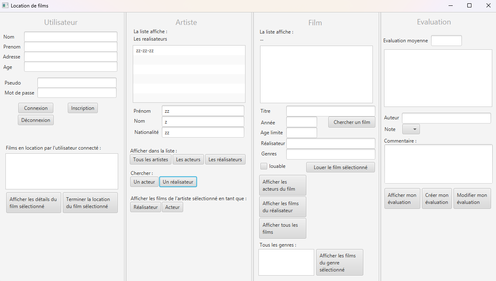
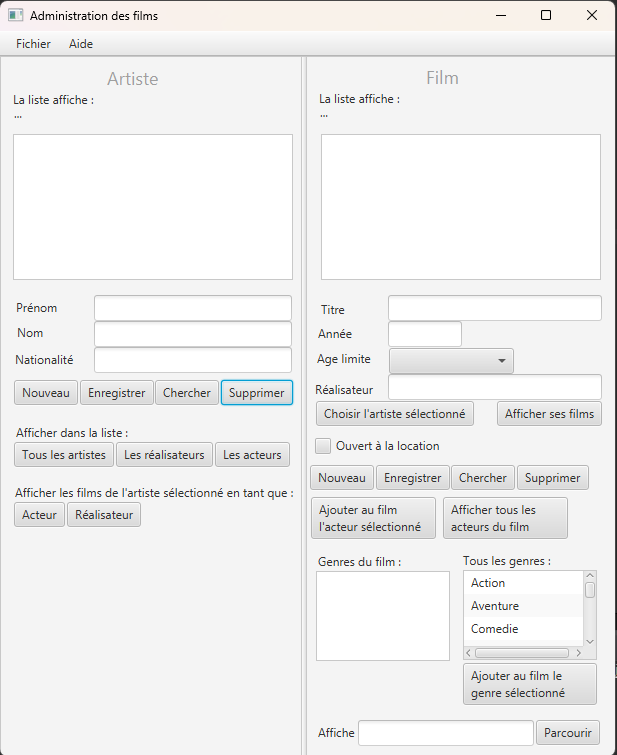
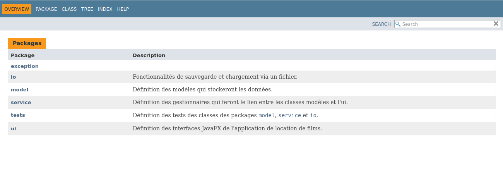
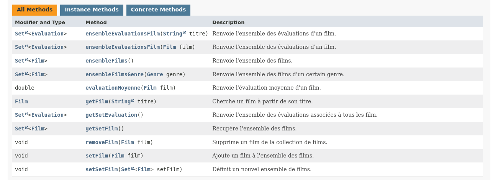
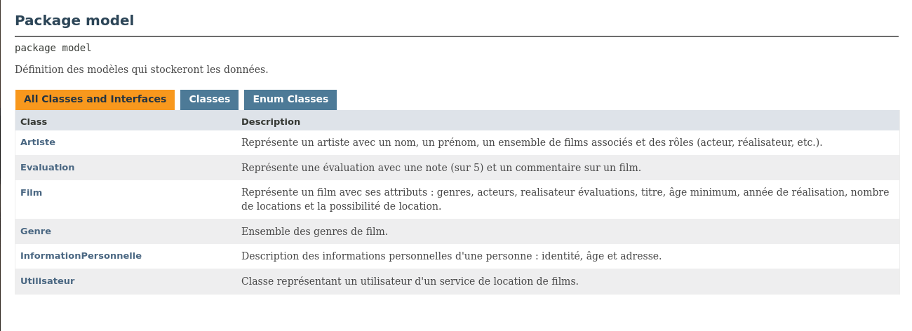

# Movie Management Desktop App

## About the Project
A movie management desktop app in Java (rating system, data saving and loading feature, JavaFX). This application provides a comprehensive platform to manage movies, artists, genres, and personalized evaluations.

The project emphasizes code quality and maintainability through a graphical interface built with JavaFX, comprehensive unit testing powered by JUnit 5, and extensive API documentation generated via Javadoc. All compilation, testing, and documentation generation tasks are efficiently orchestrated using a custom `Makefile`.

## Features
* **Film & Artist Management**: Add, modify, and search for movies, directors, and actors.
* **User System**: User registration, authentication, and personalized interactions.
* **Evaluation System**: Users can rate and review movies, with automatic average calculation.
* **Data Persistence**: Complete save and load system to ensure all application data (users, movies, evaluations, etc.) is safely stored and retrieved across sessions.
* **Custom Build System**: Fully managed via a Unix `Makefile`.

## Getting Started

### Prerequisites
* **Java Development Kit (JDK)** 17 or higher.
* A Unix-like terminal (Linux, macOS, or WSL on Windows) to execute the `Makefile`.
* `make`, `wget`, and `unzip` installed on your system.

### Available Commands
The project is driven by a `Makefile` located at the root of the repository. Open your terminal at the project root and use the following commands:

* **`make run`**
  Compiles the source code, copies the necessary FXML resource files, and launches the JavaFX application.
  
* **`make test`**
  Compiles the project and runs the entire JUnit 5 test suite using the Console Launcher.

* **`make javadoc`**
  Generates the complete HTML documentation for the project (including private classes and methods, if configured) in the `doc/` directory.

* **`make clean`**
  Removes all generated files, including the compiled `.class` files in the `bin/` directory and the generated `doc/` folder.

## Application Screenshots

### User Interface

### Administrator Interface

## Documentation (Javadoc)

The source code is heavily documented. You can generate and browse the Javadoc locally using `make javadoc`.

### Javadoc - Home

### Javadoc - GestionFilms Class

### Javadoc - Model Package

